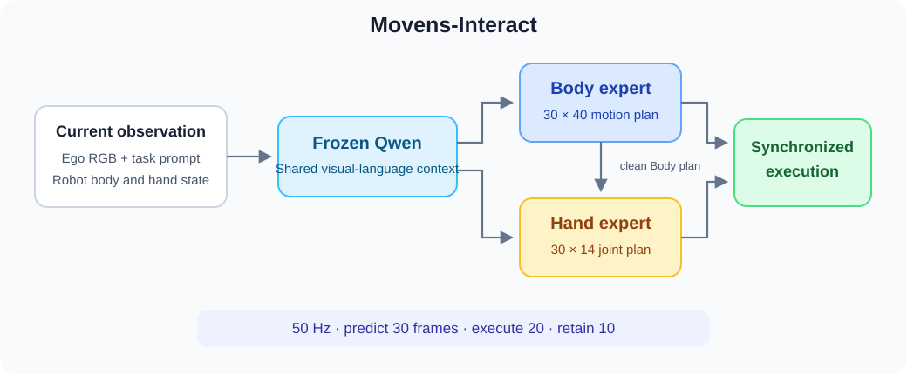

<div align="center">

# Movens-Interact

### Body and Hand Action Experts for Humanoid Manipulation

<p>
  <a href="https://github.com/wendell0218/Movens-Interact"></a>
  <a href="https://huggingface.co/wendell0218/Movens-Zero-XL"></a>
  <a href="https://huggingface.co/datasets/nvidia/GR00T-N1.7-AppleToPlate"></a>
  <a href="https://github.com/wendell0218/Movens-Zero"></a>
</p>



</div>

Movens-Interact extends Movens-Zero with separate Body40 and Hand14 action experts.
The Hand expert reads the completed Body plan and controls both hands in one
14-dimensional stream. This release includes Apple-to-Plate data preparation,
training, offline inference, and a fixed-base MuJoCo simulation.

## TODO

- [x] Body and Hand model implementation
- [x] Data preparation and paired simulation demonstrations
- [x] Training and checkpoint inference
- [x] Closed-loop simulation and scene-variation evaluation
- [ ] Robust generalization across object placements and appearances
- [ ] Real-time whole-body controller integration

## Table of Contents

- [1. Install](#1-install)
- [2. Download Models](#2-download-models)
- [3. Offline Inference](#3-offline-inference)
- [4. Training](#4-training)
- [5. Simulation](#5-simulation)
- [6. Evaluation](#6-evaluation)
- [7. Results](#7-results)
- [License and Acknowledgments](#license-and-acknowledgments)

## 1. Install

```bash
git clone https://github.com/wendell0218/Movens-Interact.git
cd Movens-Interact
conda create -n movens-interact python=3.10 -y
conda activate movens-interact
pip install -e ".[train,sim]"
conda install -c conda-forge ffmpeg
```

## 2. Download Models

Download the public XL backbone and Qwen processor files:

```bash
source scripts/download_models.sh
```

The files are written under `checkpoints/`. Model sources and checksums are listed
in [`configs/models.json`](configs/models.json).

The fitted task adapter and optional Body initialization are kept locally. Before
inference or simulation, copy a trained task checkpoint to
`checkpoints/Movens-Interact/adapter.pt`, or select it with `--checkpoint`.

## 3. Offline Inference

With a trained task checkpoint, generate one Body/Hand action chunk from the
included current-observation example:

```bash
source inference/predict.sh --checkpoint runs/apple_from_base/model_best_nominal.pt
```

See the [inference guide](inference/README.md) for observation formats, model
arguments, and outputs.

## 4. Training

After preparing the demonstration, simulator observations, and visual context,
start precision training:

```bash
source training/train.sh --no-body-init --output runs/apple_from_base
```

See the [training guide](training/README.md) for the complete data pipeline,
initialization, training parameters, and resume commands.

## 5. Simulation

Run the learned policy with current simulator images and robot-state feedback.
The released simulation uses a fixed base and pauses physics during inference.

```bash
source simulation/prepare_assets.sh
source simulation/rollout.sh --checkpoint runs/apple_from_base/model_best_nominal.pt
```

See the [simulation guide](simulation/README.md) for setup, rendering, scene
configuration, and physical success checks.

## 6. Evaluation

Evaluate the frozen model on the predefined object-position and table-appearance
cases:

```bash
source simulation/evaluate.sh --checkpoint runs/apple_from_base/model_best_nominal.pt
```

See [scene-variation evaluation](simulation/README.md) for case preparation,
batch evaluation, and output reports.

## 7. Results

The fitted adapter completes grasping and stable plate placement in the fitted
scene. A frozen-weight evaluation with one policy seed at each predefined scene
gave the following results:

| Scene | Completed / evaluated |
| --- | ---: |
| Original scene | 1 / 1 |
| Apple translated by ±1 cm along either table axis | 0 / 4 |
| Plate translated by ±2 cm along either table axis | 2 / 4 |
| Gray or blue tabletop appearance | 1 / 2 |
| Combined position and appearance changes | 0 / 1 |

Successful runs require sustained grasping, stable release, actual plate support,
and containment of the visible apple footprint. These fixed-base, single-seed
checks are not an estimate of general task success. The training reference is one
Apple demonstration; held initial-joint perturbations do not test unseen scenes.

[Watch the 20-second comparison](media/comparison.mp4).

## License and Acknowledgments

This implementation builds on [Movens-Zero](https://github.com/wendell0218/Movens-Zero),
[Qwen2.5-Omni](https://huggingface.co/Qwen/Qwen2.5-Omni-3B),
[GR00T-WholeBodyControl](https://github.com/NVlabs/GR00T-WholeBodyControl), and
[GR00T-N1.7-AppleToPlate](https://huggingface.co/datasets/nvidia/GR00T-N1.7-AppleToPlate).
The backbone, dataset, and simulator assets retain their upstream terms. See
[third-party notices](THIRD_PARTY_NOTICES.md) and [asset notices](assets/NOTICE.md).
